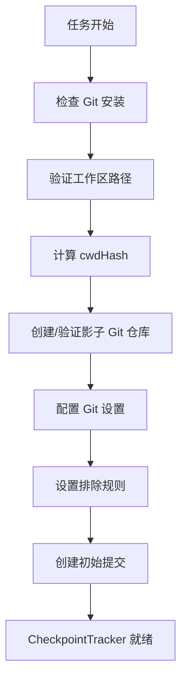
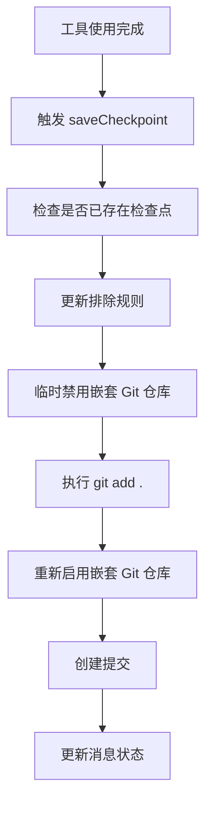
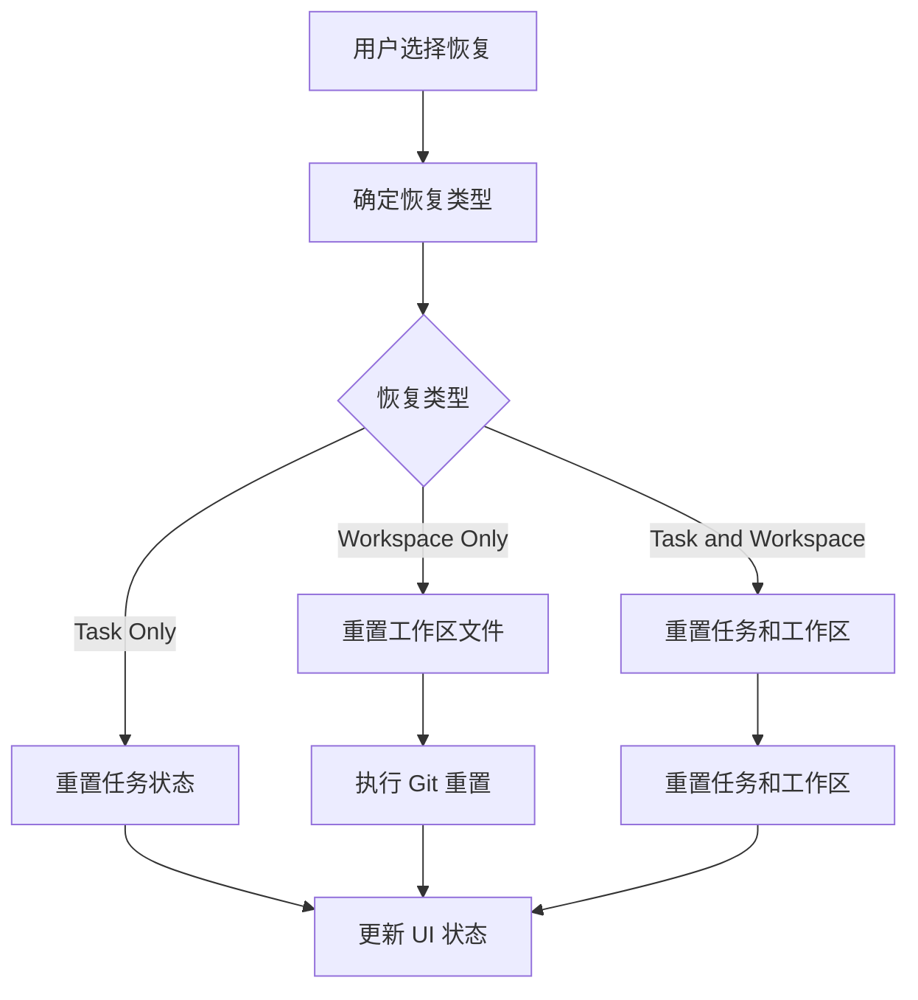

# Cline Checkpoint 原理详解

## 概述

Cline 的 Checkpoint 系统是一个基于 Git 的版本控制机制，它能够在 AI 编程过程中自动保存工作区快照，让用户能够安全地实验代码变更，并在需要时回滚到任意历史状态。该系统与用户的主 Git 仓库完全隔离，不会干扰正常的 Git 工作流程。

## 核心架构

### 1. Shadow Git Repository（影子 Git 仓库）

Checkpoint 系统的核心是创建一个独立的 Git 仓库来跟踪工作区变更：

```
globalStorage/
  checkpoints/
    {cwdHash}/
      .git/
```

**关键特性：**
- 每个工作区都有唯一的 `cwdHash` 标识
- 使用 `core.worktree` 配置指向实际工作目录
- 完全独立于用户的主 Git 仓库
- 自动配置 Git 用户信息（Cline Checkpoint <checkpoint@cline.bot>）

### 2. 工作区标识机制

```typescript
// 工作区路径哈希算法
export function hashWorkingDir(workingDir: string): string {
    let hash = 0
    for (let i = 0; i < workingDir.length; i++) {
        hash = (hash * 31 + workingDir.charCodeAt(i)) >>> 0
    }
    const bigHash = BigInt(hash)
    return bigHash.toString().slice(0, 13) // 13位数字哈希
}
```

**安全保护：**
- 禁止在敏感目录使用（home、Desktop、Documents、Downloads）
- 验证工作区访问权限
- 确保工作区路径有效性

## 核心组件

### 1. CheckpointTracker

主要的检查点管理器，负责：

```typescript
class CheckpointTracker {
    private globalStoragePath: string
    private taskId: string
    private cwd: string
    private cwdHash: string
    private gitOperations: GitOperations
}
```

**主要功能：**
- 创建和管理检查点提交
- 处理工作区验证和路径解析
- 管理 Git 工作树配置
- 提供差异比较和重置功能

### 2. GitOperations

处理 Git 相关操作的核心类：

```typescript
export class GitOperations {
    // 初始化影子 Git 仓库
    public async initShadowGit(gitPath: string, cwd: string, taskId: string)
    
    // 管理嵌套 Git 仓库
    public async renameNestedGitRepos(disable: boolean)
    
    // 添加检查点文件
    public async addCheckpointFiles(git: SimpleGit)
}
```

**关键操作：**
- 自动配置 Git 设置（用户信息、LFS、签名等）
- 处理嵌套 Git 仓库冲突
- 管理文件暂存和提交

### 3. CheckpointExclusions

文件过滤系统，确保只跟踪相关文件：

```typescript
export const getDefaultExclusions = (lfsPatterns: string[] = []): string[] => [
    // 构建产物
    "node_modules/", "dist/", "build/", ".next/", "target/",
    
    // 媒体文件
    "*.jpg", "*.png", "*.mp4", "*.mov",
    
    // 缓存文件
    "*.cache", "*.tmp", "*.log", "*.lock",
    
    // 配置文件
    "*.env*", "*.local",
    
    // 大型数据文件
    "*.zip", "*.tar", "*.db", "*.sqlite",
    
    ...lfsPatterns
]
```

## 工作流程

### 1. 初始化阶段



### 2. 检查点创建



### 3. 恢复操作



## 恢复类型详解

### 1. Restore Task Only
- **功能**：重置任务上下文，保留代码变更
- **实现**：删除指定消息之后的所有消息
- **用途**：当 AI 偏离主题但代码变更正确时

### 2. Restore Workspace Only  
- **功能**：重置工作区文件，保留对话上下文
- **实现**：使用 Git 重置到指定检查点
- **用途**：当代码变更有问题但对话有价值时

### 3. Restore Task and Workspace
- **功能**：完全重置到指定状态
- **实现**：同时重置任务状态和工作区文件
- **用途**：当需要完全重新开始时

## 技术细节

### 1. 嵌套 Git 仓库处理

```typescript
// 临时禁用嵌套 Git 仓库
public async renameNestedGitRepos(disable: boolean) {
    const gitPaths = await globby("**/.git" + (disable ? "" : "_disabled"), {
        cwd: this.cwd,
        onlyDirectories: true,
        ignore: [".git"], // 忽略根级 .git
        dot: true
    })
    
    for (const gitPath of gitPaths) {
        const newPath = disable ? gitPath + "_disabled" : gitPath.slice(0, -9)
        await fs.rename(gitPath, newPath)
    }
}
```

### 2. 提交消息格式

```typescript
const commitMessage = "checkpoint-" + cwdHash + "-" + taskId
```

### 3. 文件排除机制

使用 Git 的 `info/exclude` 文件来配置排除规则：

```typescript
export const writeExcludesFile = async (gitPath: string, lfsPatterns: string[] = []) => {
    const excludesPath = join(gitPath, "info", "exclude")
    const patterns = getDefaultExclusions(lfsPatterns)
    await fs.writeFile(excludesPath, patterns.join("\n"))
}
```

## 性能优化

### 1. 缓存机制
- 缓存工作树配置路径
- 避免重复的 Git 配置读取
- 性能监控和遥测数据收集

### 2. 异步处理
- 所有文件操作都是异步的
- 使用 `--ignore-errors` 标志处理权限问题
- 并行处理多个文件操作

### 3. 资源管理
- 自动清理临时文件
- 正确处理嵌套 Git 仓库的启用/禁用
- 异常情况下的资源释放

## 安全考虑

### 1. 路径验证
- 禁止在系统敏感目录使用
- 验证工作区访问权限
- 防止路径遍历攻击

### 2. Git 安全
- 禁用 GPG 签名验证
- 使用专用的 Git 用户身份
- 隔离的 Git 配置

### 3. 文件权限
- 尊重现有文件权限
- 优雅处理权限错误
- 不强制修改文件属性

## 使用场景

### 1. 实验性开发
- AI 可以大胆尝试不同的实现方案
- 用户可以随时回滚到稳定状态
- 支持快速迭代和原型开发

### 2. 错误恢复
- 当 AI 产生错误代码时快速恢复
- 保持对话上下文的同时修复代码
- 避免手动撤销大量变更

### 3. 版本比较
- 查看不同检查点之间的差异
- 理解 AI 的决策过程
- 学习最佳实践

## 配置选项

### 1. 启用/禁用检查点
```json
{
    "cline.enableCheckpoints": true
}
```

### 2. 排除规则自定义
- 支持 Git LFS 模式自动检测
- 可扩展的排除模式系统
- 工作区特定的配置

## 限制和注意事项

### 1. 系统要求
- 必须安装 Git
- 需要 VS Code 工作区
- 足够的磁盘空间存储检查点

### 2. 性能影响
- 每次工具使用后创建检查点
- 大型项目的检查点创建可能较慢
- 需要定期清理旧检查点

### 3. 兼容性
- 与现有 Git 工作流程完全兼容
- 支持嵌套 Git 仓库
- 跨平台兼容性

## 总结

Cline 的 Checkpoint 系统通过创建一个独立的 Git 仓库来跟踪工作区变更，提供了强大的版本控制能力，同时保持与用户主 Git 仓库的完全隔离。该系统设计精巧，考虑了性能、安全和用户体验的各个方面，是 AI 编程助手的重要基础设施。